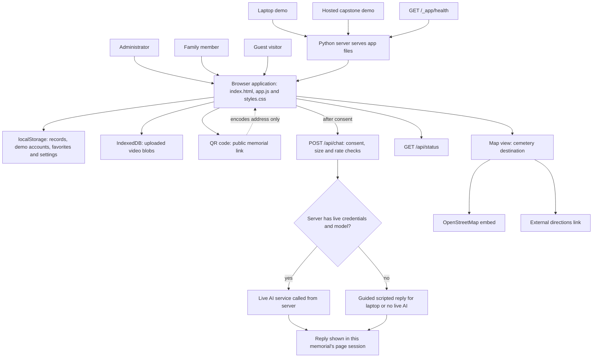
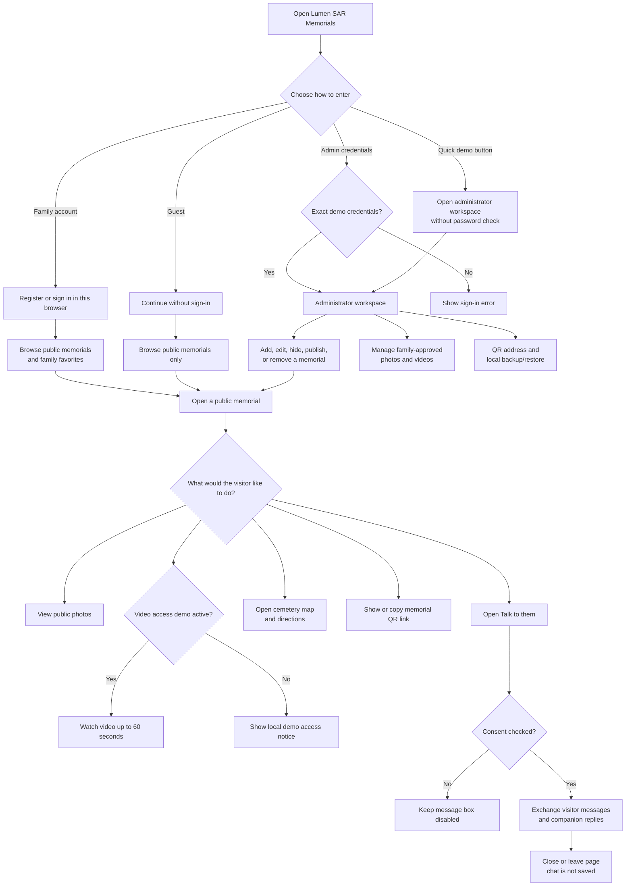
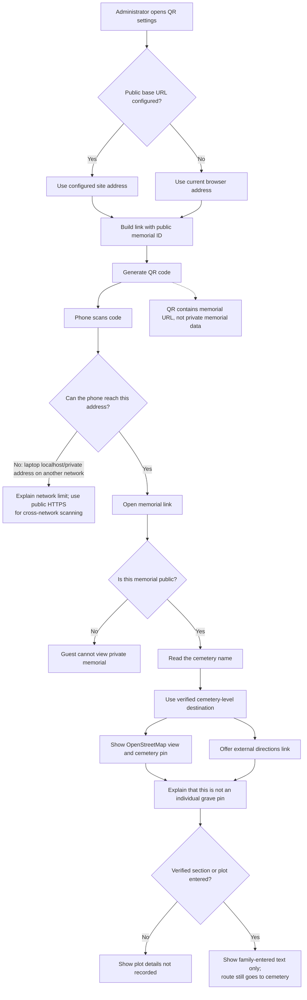
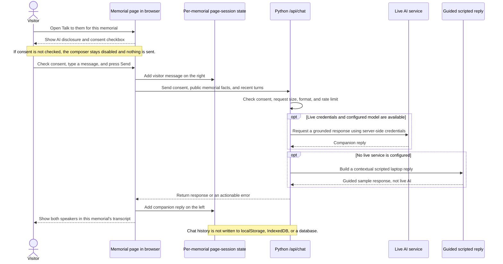
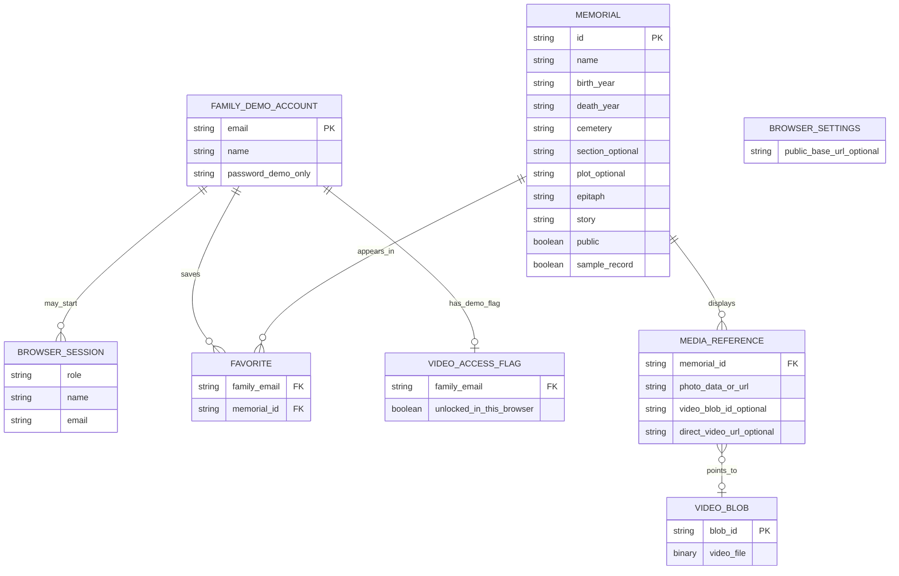

# Lumen SAR Memorials

## Software Requirements Specification (SRS)

- **Project:** Lumen SAR Memorials capstone
- **Version:** 1.1
- **Prepared:** 24 November 2026
- **Prepared by:** Student project author
- **Status:** Explains the current demonstration and lists work that would be needed before real-world use

> I wrote this document to explain my capstone in a practical way: what I built, who can use it, how the main screens connect, and what is still only a demo. I use “SRS” as the name for a project requirements document. This is not a research paper, and I am not claiming that the project follows a formal standards document. I have kept the explanations in plain English so my instructor can compare them with the working app.

## Contents

1. Purpose and scope
2. Project background and goals
3. Users and access levels
4. How the system is put together
5. Main workflows
6. What the current demo can do
7. Data handled by the system
8. Interfaces and outside services
9. Quality goals
10. Privacy, safety, and security
11. Limits and assumptions
12. Work still needed for real use
13. Demonstration checklist

## 1. Purpose and scope

Lumen SAR Memorials is my browser-based capstone for creating and viewing digital memorial pages. The sample records focus on three cemeteries in Dhaka: Azimpur, Jurain, and Banani. The project has a separate administrator workspace, a family-member experience, and a limited guest view.

A public memorial can show a person’s name, family-approved details, photographs, and a short video. Visitors can open a cemetery map, follow a link to the cemetery, share a QR code, and—after giving consent—have a two-sided conversation with the Memory Companion for that memorial.

The version I am documenting is a classroom demonstration. Some functions run only in the current browser, the built-in accounts are not secure, and local chat is a guided scripted demo unless a live AI service is available. The app should not be used to store real private family information.

The demonstration has also been deployed as a public capstone demo at [sar-lumen-jrc3scva.manus.space](https://sar-lumen-jrc3scva.manus.space). A portable laptop package is provided separately. Publishing a demo does not make the browser-local accounts or records production-safe.

## 2. Project background and goals

I wanted one respectful place where people could find a memorial and where an administrator could manage the information shown on it. I also wanted a guest to be able to browse without signing up.

My main goals are to:

- give the administrator a workspace for adding, editing, showing, hiding, and removing memorial records;
- let guests and family members view public photographs without paying;
- show video access as a simple browser demo, not as a real subscription;
- provide cemetery-level directions for Azimpur, Jurain, and Banani;
- make QR codes that open a public memorial when the phone can reach the site;
- offer a consent-based Memory Companion on each public memorial; and
- let the project run from a laptop using Python and a web browser.

The current demo does not provide a shared online account system, a shared database, real payment processing, secure production login, or an official map of individual grave plots.

## 3. Users and access levels

### Administrator

The administrator manages the sample archive in the current browser. The demonstration login is `admin@lumen.demo` with password `admin123`. The login screen also has a separate **Open administrator panel** shortcut beside **Open family account**. The shortcut skips the demo login check so I can show the admin workspace quickly in a classroom. Neither the shortcut nor the built-in password is secure authentication.

The administrator can add or edit a record, make it public or private, manage its photos and videos, configure the memorial link used in QR codes, and export or import a browser-data backup. Those changes stay in that browser.

### Family member

A family member can register or sign in on the same browser, browse public memorials, save favorites, and try the video-access demo. Public photos are free to view. The **Unlock video access** action changes a local demo flag only. It does not create a subscription, take payment, or carry across to another device.

### Guest

A guest can browse public memorials without signing in. Guests can view public photographs, open the cemetery map, use a QR link, and open a memorial’s consent-gated chat. Guests cannot use the administrator workspace or view private memorials.

## 4. How the system is put together

The project has a browser app and a small Python server. It does not use a SQL database. The browser keeps memorial records, demo accounts, favorites, the current sign-in, and video-access flags in `localStorage`. Uploaded video files are kept separately in IndexedDB. Chat messages are kept only in the open page session.

The Python server serves the app files and provides three endpoints: `/api/status`, `/api/chat`, and `/_app/health`. `/api/status` tells the page whether live AI is available. `/api/chat` checks consent and request limits, then uses live AI only when the server has valid credentials and an available model. If those are missing—as in the laptop package—the server gives a guided scripted reply instead. No credentials are stored in browser JavaScript.

The map uses an OpenStreetMap view and an outside directions link. The pin is for the cemetery destination, not a person’s individual grave. A QR code contains a link to a memorial page, not the memorial’s private details.

*Figure 1. Main parts of Lumen SAR Memorials and how the laptop and hosted demo connect.*

### 4.1 Main project files

- `index.html` starts the browser application.
- `app.js` handles sign-in, role routing, memorial pages, maps, QR codes, chat, and administrator actions.
- `store.js` loads the sample archive and saves browser-local records.
- `styles.css` controls the layout, colors, buttons, and reduced-motion behavior.
- `serve.py` serves the app and handles chat, status, and health requests.
- `assets/` contains the visual image, favicon, and QR generator used by the project.
- `docs/` contains this SRS and the diagram source files.

## 5. Main workflows

### 5.1 Choosing an entry

The sign-in screen gives the administrator, family member, and guest different ways to continue. The administrator can use the demo credentials or the separate quick-entry button. The quick-entry button is only a classroom shortcut. Family accounts are saved in the browser where they were created, and guests can browse only public records.

*Figure 2. The administrator, family, and guest entry paths, followed by common memorial actions.*

### 5.2 Administrator edits a memorial

The administrator can create a memorial or choose an existing record. The name is required. Dates and the cemetery details can be left blank if they are not known. Section or plot details should be entered only when a trusted source has provided them.

An approved photo is resized in the browser. Videos are checked for size and length, then the uploaded video file is placed in IndexedDB. The memorial record and its video reference are saved separately. A JSON backup does not contain the video blobs, so videos need to be uploaded again when moving to a different browser.

If a photo or video is invalid or browser storage is full, the app should show an error and keep the previous record where possible. Making a record private removes it from guest browsing; it does not erase the saved record.

```mermaid
%% diagram: admin
flowchart LR
  Login[Admin demo login or quick entry] --> Workspace[Administrator workspace]
  Workspace --> Choose{Create or edit?}
  Choose --> New[Create memorial]
  Choose --> Existing[Edit existing memorial]
  New --> Form[Enter name and approved details]
  Existing --> Form
  Form --> Validate{Name present and inputs valid?}
  Validate -->|No| Fix[Show error; keep existing record]
  Fix --> Form
  Validate -->|Yes| Visibility{Choose public or private}
  Visibility --> Photo{Change photo?}
  Photo -->|Yes| Resize[Resize approved image]
  Photo -->|No| Video{Change video?}
  Resize --> PhotoStore[Save photo with browser record]
  PhotoStore --> Video
  Video -->|Upload| Check[Check type, ≤100 MB, ≤60 seconds]
  Video -->|Direct link| Link[Validate HTTP or HTTPS link]
  Video -->|No change| Save[Save memorial fields in localStorage]
  Video -->|Remove| Remove[Clear reference and remove video blob]
  Check -->|Valid| Blob[Save video blob in IndexedDB]
  Check -->|Invalid| Error[Show error; preserve previous record]
  Link --> Save
  Blob --> Save
  Remove --> Save
  Visibility --> Save
  Save --> Public{Public?}
  Public -->|Yes| Shown[Visible to guests and shareable by QR]
  Public -->|No| Hidden[Hidden from guest browsing]
  Shown --> Backup[Optional JSON export/import]
  Hidden --> Backup
  Backup --> Limit[JSON excludes uploaded video blobs]
```

*Figure 3. How an administrator changes a record and its media in the browser demo.*

### 5.3 QR code and map

The QR screen builds a link for one memorial using the configured site address or the current browser address. A phone can open the link only if that address is reachable on the phone’s network. A phone on mobile data cannot reach a laptop’s `localhost` or its private university Wi-Fi address. Cross-network scanning needs a publicly reachable HTTPS site.

When a visitor opens the map, the app uses a cemetery-level destination and offers directions to that cemetery. The directions do not identify the grave. If a family or cemetery source has provided a verified section or plot, the app can show that text, but it still does not claim to guide the visitor to the exact grave.

*Figure 4. A QR link opens a memorial when reachable; maps and directions stop at the cemetery level.*

### 5.4 Memory Companion chat

Each public memorial has its own **Talk to them** button. Opening the conversation shows an explanation and a consent checkbox. Until consent is checked, the message field stays disabled. The visitor’s messages appear on the right and the Memory Companion’s replies appear on the left. The exchange remains only while that memorial page is open; it is not saved with the memorial record.

The companion is an AI, not the person who is remembered. It cannot contact the person, know what they would have said, or safely invent private memories. Live replies are available only when the server reports that a model is available. The laptop copy does not include AI credentials and uses a scripted guide that can respond to the visitor’s message but is not live AI.

*Figure 5. What happens when a visitor sends a consented message to a memorial’s companion.*

## 6. What the current demo can do

The items below describe the classroom version. “Works in the demo” does not mean that the feature is secure for a public service.

### 6.1 Sign-in and roles

- **FR-01 — Separate entry paths:** The sign-in screen has an administrator demo login, a family account path, and guest browsing. **Demo status:** Works in the browser.
- **FR-02 — Admin sign-in and shortcut:** The exact admin demo credentials open the admin workspace, and a separate quick-entry button beside the family shortcut opens it without checking a password. **Demo status:** Works, but is not secure authentication.
- **FR-03 — Family accounts:** A family member can create an account and return in the same browser. Unknown credentials are not treated as a valid account. **Demo status:** Browser-local only.
- **FR-04 — Guest limits:** A guest can browse public memorials but cannot use admin pages or open private memorials. **Demo status:** These checks are in browser code, not a server permission system.

### 6.2 Memorials and media

- **FR-05 — Memorial editing:** The administrator can add, edit, publish, hide, or delete a record with the information available to them. **Demo status:** Saved in the current browser.
- **FR-06 — Approved photos and videos:** The administrator can add, preview, replace, and remove photos or videos. **Demo status:** Uses local browser storage.
- **FR-07 — Video limits:** A demo video can be up to 60 seconds and 100 MB, depending on available browser storage. **Demo status:** The browser checks the file before saving.
- **FR-08 — No voice notes:** The app does not provide voice-note recording, uploading, playback, or management. **Demo status:** Voice notes are excluded.
- **FR-09 — Public photos:** Guests and family members can view public photos without payment. **Demo status:** Available.
- **FR-10 — Video-access action:** A family member can use one demo action to unlock video in the current browser. It does not create a payment or subscription. **Demo status:** Browser-only flag.
- **FR-11 — Starting memorial records:** The archive includes the supplied Azimpur and Jurain names and labelled fictional samples. Unknown dates, biographies, and plot information are left blank. **Demo status:** Included in the starting archive.

### 6.3 Location, QR, and chat

- **FR-12 — Cemetery maps:** The app shows a cemetery-level map and an outside directions link for Azimpur, Jurain, and Banani. **Demo status:** Uses the public cemetery destinations included with the project.
- **FR-13 — Location accuracy:** The app does not present a cemetery pin as an individual grave location. It shows a section or plot only when a verified value has been entered. **Demo status:** No official internal plot map is included.
- **FR-14 — QR codes:** The app can show, copy, and download a memorial QR code using the configured base address. **Demo status:** It works only when the phone can reach the link.
- **FR-15 — Chat consent:** The companion shows its AI disclosure and keeps the message field disabled until the visitor agrees. The server checks consent too. **Demo status:** Consent is required in the UI and endpoint.
- **FR-16 — Safer companion replies:** The companion speaks as itself, not as the deceased, and is instructed not to invent personal facts. **Demo status:** The live AI service and scripted fallback follow this rule, but a generative model may still make mistakes.
- **FR-17 — Chat is not saved:** The messages stay in the open memorial page and are not stored with the memorial data. **Demo status:** Page-session only.

### 6.4 Settings and running the project

- **FR-18 — Backup and restore:** The administrator can export or import a JSON file for browser-local records and settings. Uploaded video blobs are not inside that file. **Demo status:** Browser data can be moved; videos need to be re-added.
- **FR-19 — Laptop run:** The project can run from an extracted folder using Python’s standard-library server and the supplied launcher. **Demo status:** The server window must stay open while using the app.
- **FR-20 — Server endpoints:** The Python server provides `/api/status`, consent-checked `/api/chat`, and `/_app/health`. **Demo status:** Available from the local server and hosted container.

## 7. Data handled by the system

This diagram is a simple picture of how the demo’s data relates to itself. It is not a SQL database design: all the record and account information is saved in browser storage.

*Figure 6. The main information kept by the demo and where its uploaded video files live.*

### 7.1 Memorial record

A memorial can contain an ID, name, birth and death years, cemetery name, optional section or plot, epitaph, story, photo, video reference, public/private setting, tribute count, and a marker for fictional sample records. Unknown personal details should stay blank.

### 7.2 Accounts, favorites, and settings

The current browser stores family demo names, email addresses, passwords, and sign-in information, along with favorites and the demo video-access flag. It may also store the base URL used for public QR links. These values are not shared with another browser. The built-in admin credentials are present in the client project and are not safe for production.

### 7.3 Photos, videos, and chat

Photos and record data are browser-local. Uploaded videos are in IndexedDB; a direct video URL is only a link and must be reachable by the browser. The local JSON backup does not contain the uploaded video file itself. Chat requests include the visitor’s current messages and selected public memorial facts after consent. The app does not save the chat to its data store. Visitors should not type sensitive information.

## 8. Interfaces and outside services

- **Browser:** A modern browser with JavaScript modules, `localStorage`, and IndexedDB is needed. The layout is intended for laptop demos and phone viewing.
- **Local server:** Open the app through the Python server, normally at `http://localhost:5500`. Opening `index.html` directly as a `file://` page is not supported.
- **Map:** The embedded map uses OpenStreetMap. Directions open an outside map service and lead to the cemetery destination, not an individual plot.
- **Chat status:** `GET /api/status` tells the page whether the server can use live AI or should show scripted demo mode.
- **Chat request:** `POST /api/chat` requires `consent: true` and a current visitor message. The server limits request size and frequency. Any live-AI credentials stay on the server.
- **QR code:** The QR generator runs in the browser. For a phone on mobile data, the memorial link must use a public reachable HTTPS address.

## 9. Quality goals

- **Easy to understand:** The login screen should make admin, family, and guest entry clear. The admin shortcut should be easy to spot next to the family shortcut.
- **Respectful:** The page should use calm colors and readable text. The app should not invent personal details, dates, or grave locations.
- **Works on different screens:** Main views should fit a laptop and a phone screen.
- **Basic accessibility:** Controls need clear labels, readable contrast, keyboard access where supported, and reduced-motion behavior.
- **Clear privacy message:** Visitors should understand what the companion is, what consent sends, and that chat is not saved.
- **Helpful errors:** When a chat request or media upload fails, the app should explain the issue and avoid silently removing an existing record.
- **Easy laptop setup:** The local copy should run with Python installed and without a separate JavaScript package installation.
- **Honest map information:** The app must not imply that a cemetery pin is the exact grave.

## 10. Privacy, safety, and security

The demo checks administrator and family roles in browser code. Someone can inspect or change that code and browser data. Demo passwords are stored in browser-local data, and the admin shortcut intentionally bypasses the login check. This is acceptable only for a classroom demonstration with sample data. Do not use real passwords or private family records in this copy.

Before real use, the app would need server-managed accounts, secure password storage, server-side role checks, protected photo and video storage, backups, account recovery, consent records, and clear processes for correcting or deleting memorial information. Real subscription features would also need payment processing and secure entitlement checks. The current video button does none of that.

The Memory Companion must remain clearly identified as AI. It cannot contact the deceased, represent their thoughts, or provide counselling. It should not invent memories or encourage someone to rely on it instead of people in their life. If a visitor describes immediate danger or self-harm, the reply should encourage them to contact a trusted person and local emergency or crisis support now.

Map pins identify cemeteries only. A verified section or plot number may be displayed as text, but the project does not include an official internal cemetery map or an accurate path to the individual grave.

## 11. Limits and assumptions

- Memorial records, family accounts, and settings are saved in the browser where they were created. They do not sync between devices.
- The laptop package has no live AI credentials. Its replies are guided scripted demo text, not live AI. Live chat depends on server credentials and model availability.
- The companion is not the deceased and cannot know their thoughts, memories, wishes, or voice.
- Cemetery locations do not identify individual graves, internal pathways, or confirmed plot coordinates.
- A QR code using `localhost` or a private network address will not work from a phone on a different network. Public HTTPS hosting is needed for cross-network scanning.
- Video access is a local demonstration flag. No subscription, recurring charge, or payment is created.
- Records or media may be lost if browser data is cleared. JSON backup does not include uploaded video blobs.
- Fictional samples are labelled. Real details should only be added with permission and a reliable source.
- The published website and laptop package are capstone demos, not production memorial services.

## 12. Work still needed for real use

A production version would need a secure backend and database so records and accounts can be protected and shared. The server would need to decide which users can add or edit a memorial. Passwords would need to be stored securely, and media would need durable storage, access rules, and backups.

If the project later adds subscriptions, it needs real payment rules, receipts, cancellation handling, and secure checks for who can view a video. If it needs directions to a person’s individual grave, it first needs an official cemetery plot map and verified plot data. The chat feature would need a clear retention policy, cost controls, provider review, and a way for people to report harmful replies. Families and cemetery staff should review the service before real data is used.

## 13. Demonstration checklist

For my capstone presentation, I should be able to show that:

1. The laptop launcher opens the app through the local server; I do not open the HTML file directly.
2. The admin demo credentials and the separate **Open administrator panel** button both open the administrator workspace. The admin shortcut sits beside **Open family account** and is clearly marked as a demo shortcut.
3. A family account can register and sign in again in the same browser, and a guest can browse public records without signing in.
4. The administrator can add or edit a memorial, change whether it is public, manage photos and videos, and remove a record without silently losing unrelated records.
5. Public photos are viewable without payment. Video access is clearly labelled as a local demo.
6. The Azimpur, Jurain, and Banani map actions lead to a cemetery-level destination and do not claim to locate an individual grave.
7. A QR code opens its link when the phone can reach the address. The app explains why laptop-local or private Wi-Fi addresses do not work across networks.
8. Each public memorial has its own **Talk to them** action. Consent is required before sending a message, and the visitor and companion appear on opposite sides of the chat.
9. The companion’s replies respond to the visitor’s messages in a gentle way, use only available memorial details, and do not pretend to be the deceased.
10. The laptop copy clearly says when it is using scripted demo replies. The app only says live AI is available when the server confirms it.
11. The JSON backup restores the expected browser records and settings, and the presenter knows that uploaded videos are not included.

Passing this list means the classroom demo is ready to present. It does not mean that the app is ready for public use with real family data.
